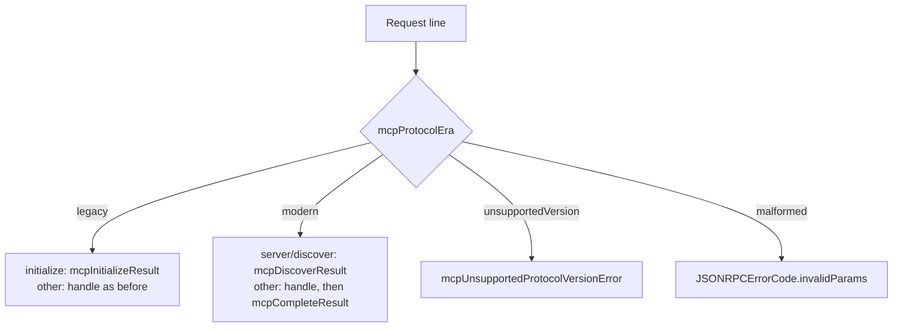

# MCPCore

Shared Swift package for the Soul-Craft Mac MCP servers: JSON-RPC types, `AnyCodableValue`, MCP builders for both
protocol eras, tool results, stdio helpers and media auditing. No third-party dependencies.

| | |
| --- | --- |
| Contract | [docs/SPEC.md](docs/SPEC.md) |
| Upgrade guide for dependents | [docs/UPGRADING.md](docs/UPGRADING.md) |
| Releases and private access | [docs/RELEASING.md](docs/RELEASING.md) |
| Changes | [CHANGELOG.md](CHANGELOG.md) |
| Swift tools, platform | 6.2, macOS 26 (Linux builds in CI) |
| MCP revisions | `2026-07-28` and `2025-11-25`, served dual-era |

## Use it

```swift
dependencies: [
    .package(url: "https://github.com/Soul-Craft/MCPCore.git", .upToNextMajor(from: "1.0.0"))
],
targets: [
    .target(name: "MyServerLib", dependencies: [.product(name: "MCPCore", package: "MCPCore")])
]
```

## API

| Need | Call |
| --- | --- |
| Decode a request line | `JSONDecoder().decode(JSONRPCRequest.self, from:)` |
| Pick the protocol era | `mcpProtocolEra(of: request)` |
| Answer `initialize` (legacy) | `mcpInitializeResult(name:version:extraCapabilities:)` |
| Answer `server/discover` (modern) | `mcpDiscoverResult(name:version:extraCapabilities:instructions:cache:)` |
| Mark a modern result complete | `mcpCompleteResult(_:serverName:serverVersion:cache:)` |
| Reject an unknown version | `mcpUnsupportedProtocolVersionError(requested:)` |
| Describe a tool | `mcpToolAnnotations(readOnly:destructive:idempotent:openWorld:)` |
| Return a tool result | `ToolResult.text`, `ToolResult.error`, `mcpEncodeToolResult` |
| Write to stdout | `mcpSendResponse`, `mcpSendToolError` |
| Log | `mcpLog(prefix, message)` (stderr) |
| Survive a closed pipe | `mcpSetupSignalHandling()` |
| Report media coverage | `MediaAuditReport`, `MediaSkipReason` |



## Develop

```bash
swift build
swift test --filter MCPProtocolEraTests   # one test case at a time locally
Scripts/check-dependents.sh               # on the Mac: build every dependent against this tree
```

Change `Sources/` through a pull request with tests. Dependents pick changes up by moving to a new tag.
The archived [Soul-Craft/MacApps](https://github.com/Soul-Craft/MacApps) monorepo was the original home of this code.

## License

[MIT](LICENSE), copyright 2026 Soul-Craft.
