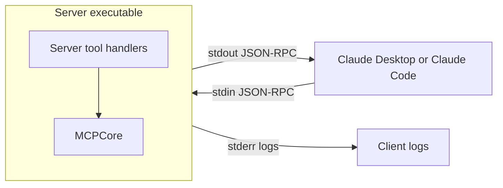

# MCPCore specification

MCPCore is the shared Swift package for the Soul-Craft Mac MCP servers.
This page is the contract that dependents build against.
It is versioned with the package: the copy at a tag is the contract for that tag.

## At a glance

| Item | Value |
| --- | --- |
| Product | `MCPCore` library, one module |
| Dependents | Messages, WhatsApp (Groups and Communities), Contacts, GIFMaker (planned) |
| Swift tools | 6.2 |
| Platforms | macOS 26 (supported), Linux (CI only, Swift 5 language mode) |
| Dependencies | None. Foundation and the C library only |
| Transport | stdio, newline-delimited JSON-RPC 2.0 |
| MCP revisions | `2026-07-28` (modern) and `2025-11-25` (legacy), served dual-era |
| Versioning | Semantic versions, tags `vMAJOR.MINOR.PATCH`, from `v1.0.0` |

## Scope

| In scope | Out of scope |
| --- | --- |
| JSON-RPC 2.0 envelope types and error codes | A server loop or dispatcher (each server owns its own) |
| `AnyCodableValue` for free-form JSON | Streamable HTTP transport, OAuth, sessions |
| MCP builders: `initialize` result, `server/discover` result, tool annotations | Resources, prompts and sampling builders beyond capability flags |
| Protocol era detection from a request (`initialize` or `_meta`) | Tasks extension, Multi Round-Trip Requests (elicitation), Skills over MCP (see Roadmap) |
| Tool results (text and image content) and their encoding | Server business logic (databases, media processing) |
| stdout writer, stderr logger, SIGPIPE setup | Third-party packages of any kind |
| Media audit report shared by servers that process media | MCPB packaging (each server ships its own bundle) |

## Public API by file

| File | Public symbols | Purpose |
| --- | --- | --- |
| `AnyCodableValue.swift` | `AnyCodableValue` and its accessors | Type-erased JSON value |
| `JSONRPCTypes.swift` | `JSONRPCRequest`, `JSONRPCResponse`, `JSONRPCError` | Wire envelope |
| `MCPConstants.swift` | `mcpProtocolVersion`, `JSONRPCErrorCode`, `mcpInitializeResult`, `mcpToolAnnotations`, `mcpSetupSignalHandling` | Legacy handshake and shared constants |
| `MCPProtocol.swift` | `MCPProtocol`, `MCPProtocolEra`, `mcpProtocolEra(of:)`, `mcpDiscoverResult`, `mcpCompleteResult`, `mcpUnsupportedProtocolVersionError` | Dual-era support for the `2026-07-28` revision |
| `MCPResponseWriter.swift` | `mcpSendResponse`, `mcpEncodeToolResult`, `mcpSendToolError`, `mcpLog` | Output |
| `ToolResultTypes.swift` | `ToolResult`, `ToolContentBlock` | Tool call results |
| `MediaAudit.swift` | `MediaAuditReport`, `MediaSkipReason` | Media processing audit block |

Anything not marked `public` is internal and may change in any release.

## Protocol revisions

The MCP `2026-07-28` revision removed the `initialize` handshake and made every request carry its own protocol version in `_meta`.
It defines three kinds of implementation: legacy, modern and dual-era.
MCPCore servers are dual-era, so both old and new clients work.

| Client sends first | MCPCore reports | Server does |
| --- | --- | --- |
| `initialize` | `.legacy` | Reply with `mcpInitializeResult` (version `2025-11-25`), then serve as before |
| Any request whose `_meta` has `io.modelcontextprotocol/protocolVersion` = `2026-07-28` and an `io.modelcontextprotocol/clientCapabilities` object | `.modern("2026-07-28")` | `server/discover`: reply with `mcpDiscoverResult`. Others: handle, then wrap with `mcpCompleteResult` |
| The same, with a version this package does not serve | `.unsupportedVersion(v)` | Reply with `mcpUnsupportedProtocolVersionError(requested:)` (code `-32022`) |
| `_meta` has one modern key but not both, or a non-string version | `.malformed` | Reply with `invalidParams` (`-32602`) |
| `server/discover` with no modern `_meta` keys | `.malformed` | Reply with `invalidParams` (`-32602`) |
| Anything else (no modern `_meta` keys, not `initialize`) | `.legacy` | Serve as legacy, as servers do today |

Modern results carry `resultType: "complete"` and `_meta.io.modelcontextprotocol/serverInfo`.
Results of `server/discover` and `tools/list` also carry `ttlMs` and `cacheScope`.
`mcpCompleteResult` adds these fields when it is given a cache hint.

### Sources for the protocol decisions (read 2026-11-25)

| Fact | Source |
| --- | --- |
| `2026-07-28` removes `initialize` and the session header, adds `server/discover`, `resultType`, caching fields | [Changelog](https://github.com/modelcontextprotocol/modelcontextprotocol/blob/main/docs/specification/2026-07-28/changelog.mdx) |
| Legacy, modern and dual-era servers, and the compatibility matrix | [Versioning](https://github.com/modelcontextprotocol/modelcontextprotocol/blob/main/docs/specification/2026-07-28/basic/versioning.mdx) |
| stdio clients probe with `server/discover` and fall back to `initialize` on any other error | [stdio transport](https://github.com/modelcontextprotocol/modelcontextprotocol/blob/main/docs/specification/2026-07-28/basic/transports/stdio.mdx) |
| `DiscoverResult` shape | [Discovery](https://github.com/modelcontextprotocol/modelcontextprotocol/blob/main/docs/specification/2026-07-28/server/discover.mdx) |
| `ttlMs` and `cacheScope` are required on discover and list results | [Caching](https://github.com/modelcontextprotocol/modelcontextprotocol/blob/main/docs/specification/2026-07-28/server/utilities/caching.mdx) |
| Tasks moved to the `io.modelcontextprotocol/tasks` extension; elicitation now uses Multi Round-Trip Requests | Changelog, items 6 and 7 |
| Claude: Skills over MCP in public beta, Tasks and Elicitation generally available, File Uploads coming (2026-11-24) | [Claude article](https://claude.com/resources/articles/skills-over-mcp-tasks-and-more) |
| Claude rollout of `2026-07-28` is "rolling out across Claude products"; it does not say which version Claude Desktop sends to stdio servers | [Claude article](https://claude.com/resources/articles/bringing-mcp-2026-07-28-to-claude) |

## Decisions

| # | Question | Decision | Why |
| --- | --- | --- | --- |
| a | Build on the official Swift SDK? | No. Keep MCPCore's own types | `modelcontextprotocol/swift-sdk` 0.12.1 implements `2025-11-25` only, depends on swift-system, swift-log, eventsource and an unpinned swift-docc-plugin branch, and is pre-1.0 with breaking minor releases (its README, Package.swift and releases page, read 2026-11-25). The repo rule is zero third-party dependencies |
| b | Which revision? | Dual-era: modern `2026-07-28` plus legacy `2025-11-25` | The spec allows dual-era servers, and no primary source says which revision Claude Desktop sends to stdio servers today |
| c | Tasks, Elicitation, Skills in v1.0.0? | Out of v1.0.0. Planned as minor releases | Each is an extension or pattern with its own wire shape. No dependent tool needs them yet. Adding them later is additive, so it is a minor release under the policy below |
| d | Ship servers as MCPB bundles? | Yes. Each server ships its own `.mcpb`, with MCPCore pinned by tag in its `Package.resolved` | The registry `server.json` format lists `registryType: "mcpb"` packages hosted on GitHub Releases ([generic server.json](https://github.com/modelcontextprotocol/registry/blob/main/docs/reference/server-json/generic-server-json.md), read 2026-11-25). Dependents' threads apply this when they switch to the tag |

## Versioning policy

| Change | Release |
| --- | --- |
| Remove or rename a public symbol, change a signature, change encoded JSON for existing input, raise the platform or tools version, drop a protocol revision | Major |
| Add a public symbol, add a parameter with a default, add a protocol revision or extension helper | Minor |
| Bug fix with no API change, docs, tests, CI | Patch |

Note: adding a case to a public enum breaks exhaustive `switch` statements in dependents.
So a new case in `MediaSkipReason`, `MCPProtocolEra` or `ToolContentBlock.BlockType` is a major release.

Tags are immutable once pushed.
Dependents use `.upToNextMajor(from: "1.0.0")` and commit `Package.resolved`.

## Concurrency and language mode

| Rule | Detail |
| --- | --- |
| Language mode | Swift 6 on macOS. Swift 5 on Linux CI only, because Glibc declares `stdout` and `stderr` as mutable globals |
| Sendable | Every public type is `Sendable` |
| Global state | None, except the C `stdout` and `stderr` streams |
| Writer | `mcpSendResponse` is not thread-safe. A server that writes from more than one thread wraps it in its own lock |

## Errors

| Code | Name | When |
| --- | --- | --- |
| `-32700` | `parseError` | Input line is not JSON |
| `-32600` | `invalidRequest` | Not a JSON-RPC request |
| `-32601` | `methodNotFound` | Unknown method |
| `-32602` | `invalidParams` | Bad or missing params, including a modern request without required `_meta` fields |
| `-32603` | `internalError` | Server bug |
| `-32022` | `unsupportedProtocolVersion` | Modern request with a version the server does not support; `data` lists `supported` and `requested` |

A tool that fails returns a normal result with `isError: true` (`mcpSendToolError`), not a JSON-RPC error.

## stdout rules

| Rule | Why |
| --- | --- |
| stdout carries only JSON-RPC messages, one per line | The stdio transport frames messages by newline |
| No `print` anywhere else in a server | One stray line breaks the client's parser |
| Logs go to stderr through `mcpLog` | Claude Desktop shows stderr in its MCP logs |
| Flush after every message | Pipes are block-buffered |
| Ignore SIGPIPE (`mcpSetupSignalHandling`) | The client may close the pipe at any time |

## Security rules

| Rule | Detail |
| --- | --- |
| No dependencies | Nothing outside Foundation and the C library |
| No network or file access in MCPCore | Servers own all I/O beyond stdio |
| No secrets in logs | `mcpLog` callers never log tokens, message bodies or contact details |
| Decoding is total | `AnyCodableValue` decodes any JSON without trapping; unknown shapes become `.null` |
| Reports | See `SECURITY.md` |

## Roadmap

| Release | Adds |
| --- | --- |
| 1.1 | Multi Round-Trip Requests (`resultType: "input_required"`) for elicitation |
| 1.2 | Tasks extension (`io.modelcontextprotocol/tasks`) helpers |
| Later | Skills over MCP once its extension page can be read from a primary source |
